# Valheim
Valheim is a game developed by https://irongate.se/ 
 
# Valheim Description
Valheim is a survival type of game, food plays an important role in the player's survivability. 
 
# Disclaimer

Download the Valheim worlds that are shared here and feel free to make them your own. I don't want them back. But,
of course, use them at your own risk, I make no warantee or guarantee's concerning them.

## Note

- You can destroy and re-build any beds that you find in the shared worlds so that you can claim them as your own. 

- The worlds are based on vanilla (default) Valheim, no mods are required to use them. 

 - On Oct 7, 2026 I noticed that my twitch intro videos were being deleted. I am working on copying any videos that weren't deleted over to YouTube and will
eventually create any missing videos. Sorry for any inconvenience.

# Installation

1. Download the compressed file, i.e. MainBase.7z.

2. Extract (expand) the file.

3. In the case of the new save format after version 1.0 of Valheim, there will be a folder which is named after the world and the folder contains files.

Prior to version 1.0, world saves consisted of two files.

Copy the folder together with the contained files (or the 2 files from any old saved worlds) into the local worlds save location for Valheim.

On a PC that location is in your profile in this location:

%USERPROFILE%\AppData\LocalLow\IronGate\Valheim\worlds_local (on Windows)

or

~/.config/unity3d/IronGate/Valheim/worlds_local (on Linux)

On my system, this location looks like this: C:\Users\rtayl\AppData\LocalLow\IronGate\Valheim\worlds_local 

4. After the folder (or old world files) has been copied into the correct location, when you log in to Valheim the world will show up as one of the worlds that you can log into. 

## The MainBase intro video includes steps to install the world
https://youtu.be/MR2HREsp7mE

# SuperCrypt40 World  
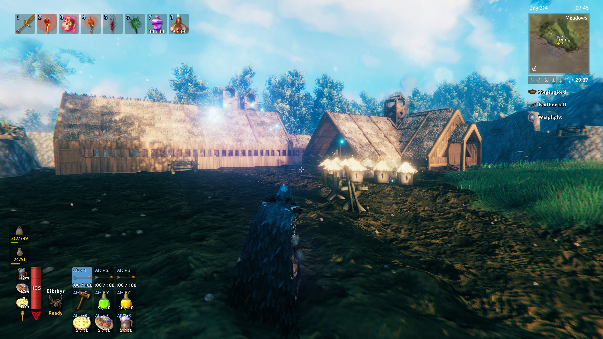

The SuperCrypt40 world is based on the seed: WBFzViM6sG

The image above is the main base that was built near the spawn.

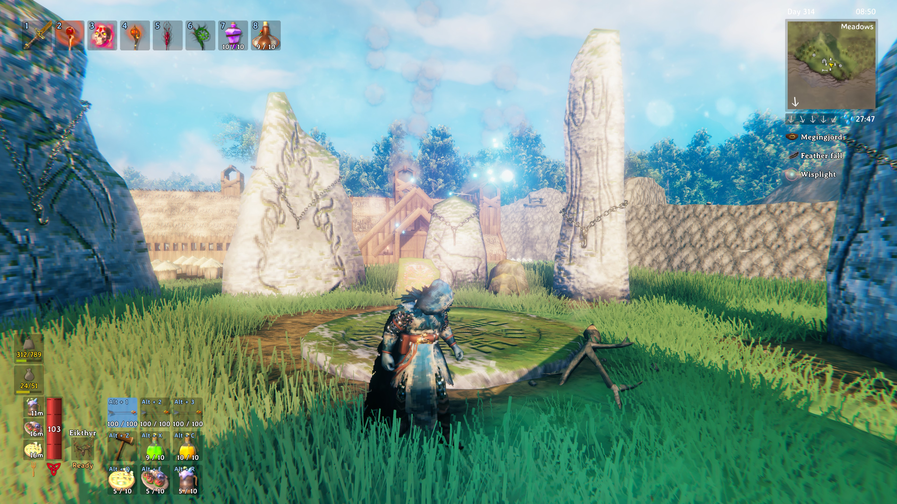

 - No bosses have been killed yet

 - There are bases built in either the Meadows or the Black Forest that I have built throughout the world in strategic locations. 

## An Orientation/Itroductory Video of the SuperCrypt40 world (29 minutes)
https://youtu.be/_CmMShQO5eI
  

# Solo World (based on the SuperCrypt40 World)

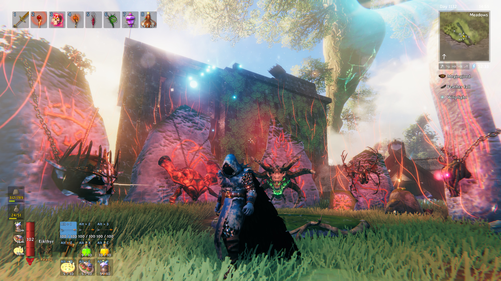

The files Solo.7z.001 and Solo.7z.002 are the Supercrypt40 map which I have renamed to Solo. This map is after I have explored Ashlands and defeated Fader.

Latest upload as of Sept 22, 2026.

I made sure that the Deep North has generated correctly and I have actually started working in the Deep North. You will find some Deep North items in various chests in the Marble Fortress
that is located at the Spawn. I had to ask 7zip to break it into 2 files because of upload file size limits on Github. Use 7zip to open the first file and have the other file in the same 
directory/folder, 7zip should automatically find the other file. 

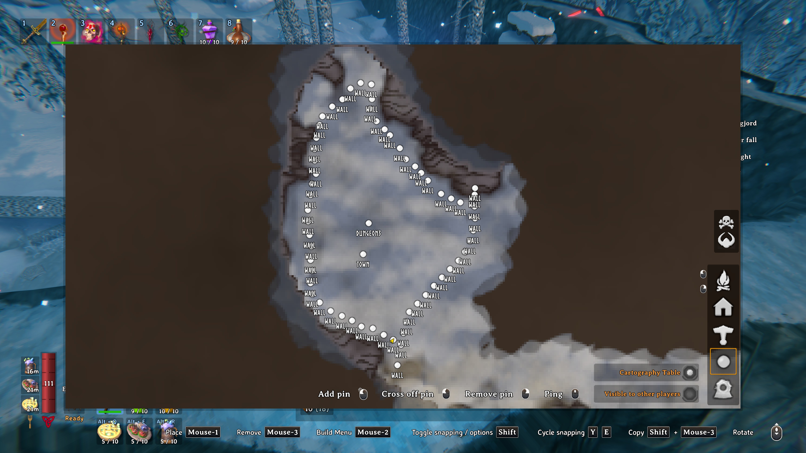

I built a new walled off area in the Deep North and then saved the Solo world to this repo so that you can decide what will be built there.

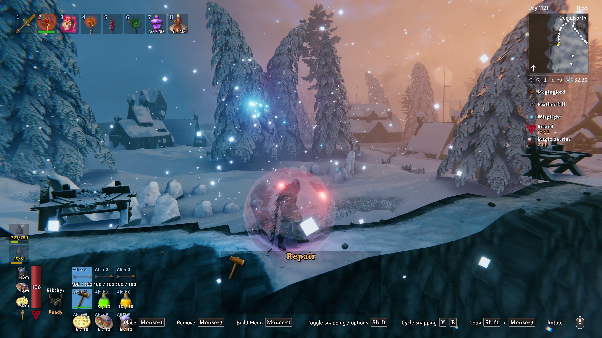

The above is one of the views from the new wall.

The latest Solo world update includes upgraded armor and the discovery of the Forge of Potential location.

# MainBase World

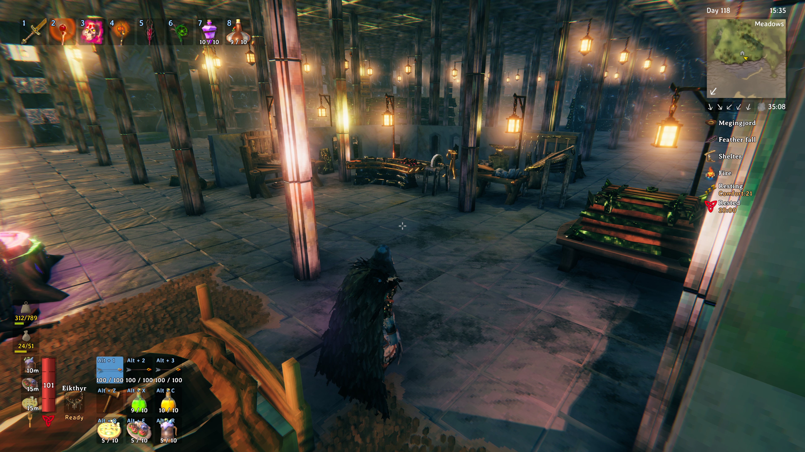

The MainBase.7z is my storage world that I created to save all my stuff from several different Valheim worlds. 

This was created from the seed: KQ3EHPZVA

There is one big marble building with a portal from the spawn area to it.

Spoiler alert! Practically all the items from the game can be found in one of the chests in the marble building.

This was updated here on November 12, 2026

Latest update has some Writhan trophies and Writhan roots.

In the below intro video, I also discuss how to make a copy of a world in case that is of interest to you.
## Video intro for MainBase
https://youtu.be/MR2HREsp7mE

# sc40main World

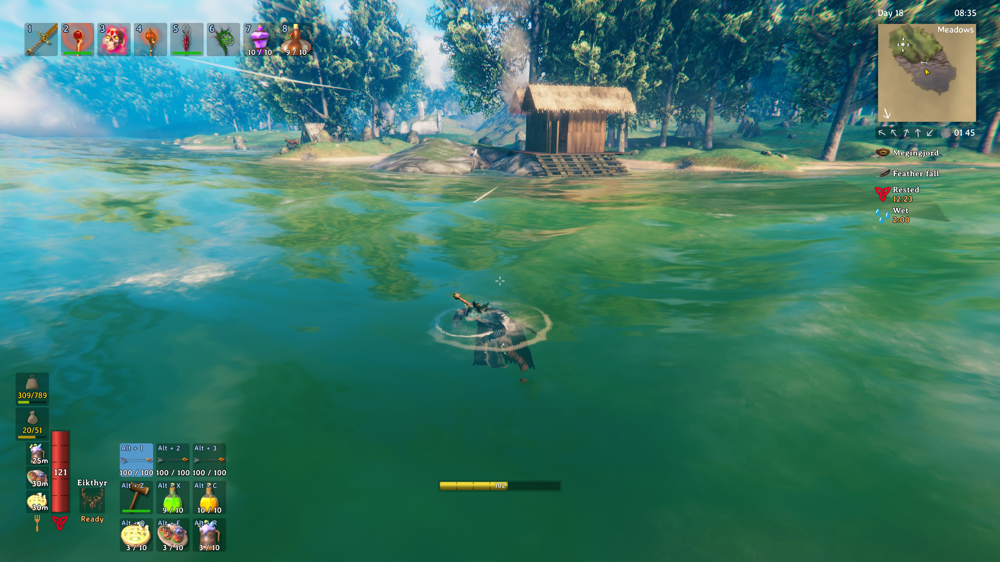

sc40main.7z is a new world using my favorite seed: WBFzViM6sG. I have created a shack on the beach to aid with my swimming training. It may help someone new
to get started with a new character. I left 4 of my spawned skeletons from my main character behind but unfortunately, they won't follow you and they will disappear. 

# Bonemass_arena World

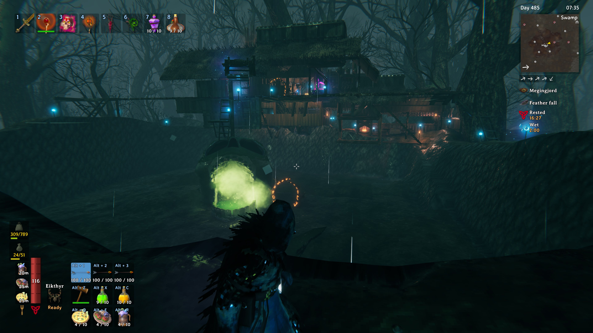

bonemass_arena.7z is a copy of the Supercrypt40solo world that has been altered to provide a sort of arena (training area) for defeating Bonemass. It is
useful for training (leveling skill) in various weapons. Find the Bonetree portal and travel there to get to the arena.

Last updated: November 16, 2026

# block_trainer World

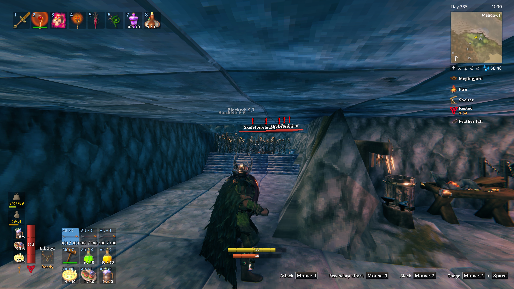

block_trainer.7z is another copy of the Supercrypt40solo world. I built an underground block trainer near the Bonefort that is full of skeleton archers. You
can more quickly level up your block but it can be dangerous so watch the video to see how it works.

## Intro Video for block_trainer
https://www.youtube.com/watch?v=J1opGYYSbOs

# SoloFin World

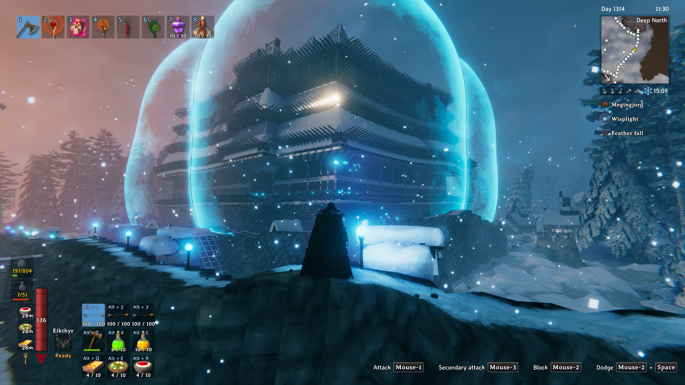
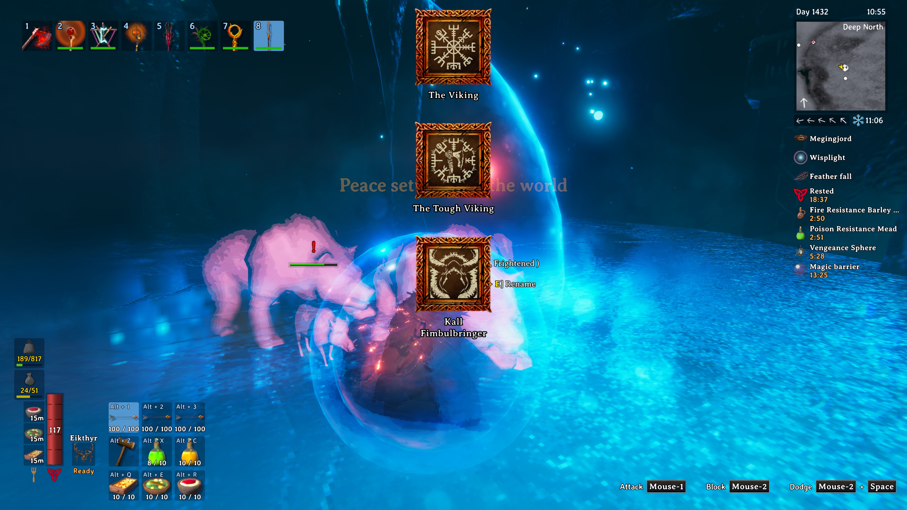

This is the continuation of the Solo World that was based on the the SuperCrypt40 World.

There are 3 files that you will need to download and extract to recover this world for your system. Use 7zip to extract the first file and have the other 2 files in the same directory
and they will also be extracted.

You can see an image of the fortress that I built in the Deep North, as well as the achievements that I recevieved
when I defeated the final boss.

A word of caution, not only will you see items and locations that could be considered a spoiler when you examine this world,
but there are spawns from virtually all of the biomes that can show up in any biome including the beginner Meadows biome so be careful as you 
look around.

# Templates.7z

Note that for now this 7zip file is password protected

The target audience for this file would be a veteran Valheim player who would like to start a new play-through with a character that already has some skills leveled up to 100.

Inside Templates.7z, which was a folder that was compressed by 7zip, you will find Template.fch. This is a character file which has special
characteristics and a special purpose. By using a mod called CharacterEditButton v0.9.1 by cjayride, you are able to rename the
character and change his appearance. For the ladies, you can even make the character a female.

To start, extract the zip and copy the Template.fch file to your characters_local folder in the Valheim save directory.

%USERPROFILE%\AppData\LocalLow\IronGate\Valheim\characters_local (on Windows)

or

~/.config/unity3d/IronGate/Valheim/characters_local (on Linux)

On my system, this location looks like this: C:\Users\rtayl\AppData\LocalLow\IronGate\Valheim\characters_local 

You can rename the file first but then in the characters list in Valhiem it will show up like this: newname(Template)

Once you have the CharacterEditButton mod installed, when you start Valheim you will be able to select the Template character
name and click Edit in order to rename the character and change his appearance.

If you did not already rename the file to match your new character name you should exit Valheim and rename the file now so that
it matches the name that you used for your character.

Once that is done you can use this new character of yours for a new play-through in Valheim.

Some characteristics of this Template character are:

 - This character has not died yet.

 - This character has not killed any bosses yet.

 - He has played through the starting Biome (the Meadows) and completed a few achievements as well as interacted
with Hugin the Raven. As a result, this is probably not a template that a user who is new to Valheim should use.

 - He has also visited other worlds and leveled up 13 skills to 100.

 - He has seen things that a new character should not normally see until much later in the game.

 - He is equipped with a rag tunic and a torch just like a new player would be.

# Video Streams/Streamers that use SuperCrypt40 as their world
https://www.twitch.tv/loficody

# Video Reviews of the SuperCrypt40 world.
....

